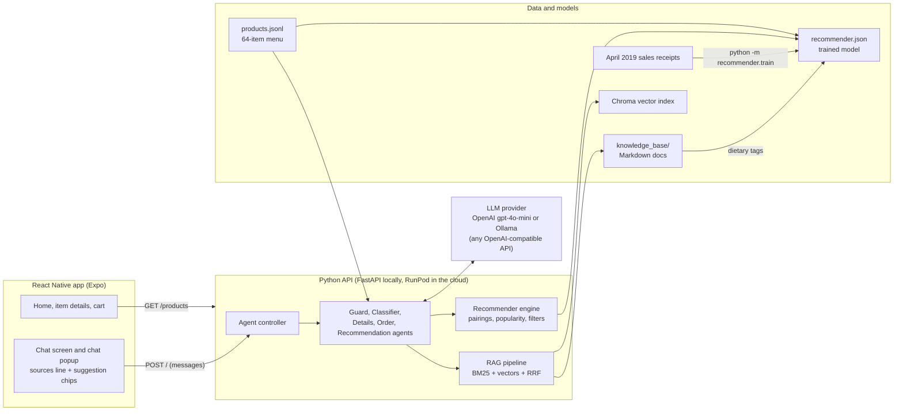
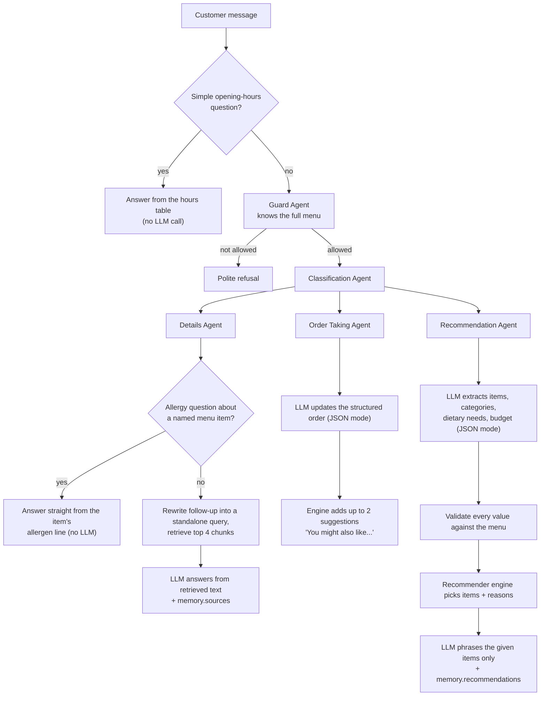
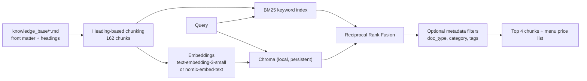
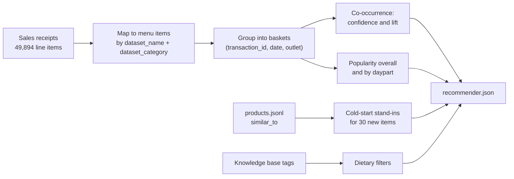

# Architecture and Project Write-up

This document explains how the Bleecker & Bloom coffee shop assistant works and what was built on top of the original agent-based chatbot. For setup commands, see [python_code/api/README.md](python_code/api/README.md).

**In one paragraph:** a React Native app talks to a Python API that routes each customer message through a small team of LLM agents. A guard filters off-topic requests, a classifier picks the right specialist, and three specialists do the work: a **Details Agent** that answers questions with hybrid retrieval (RAG) over a Markdown knowledge base, an **Order Taking Agent** that keeps a structured cart, and a **Recommendation Agent** that asks the LLM only to understand the request and leaves the choice of items to a recommender trained on 39,192 real sales baskets. Both the RAG pipeline and the recommender have offline evaluations, and the numbers below come from them.

## Contents

1. [System overview](#1-system-overview)
2. [How a message is handled](#2-how-a-message-is-handled)
3. [Components](#3-components)
4. [Data](#4-data)
5. [Evaluation results](#5-evaluation-results)
6. [What was built](#6-what-was-built)
7. [Design decisions](#7-design-decisions)
8. [Known limitations and next steps](#8-known-limitations-and-next-steps)
9. [Repository map](#9-repository-map)

---

## 1. System overview



- **One menu source.** `python_code/products/products.jsonl` feeds the app's product list, every agent prompt, and the recommender. Nothing else keeps its own copy of the menu.
- **Provider-agnostic LLM.** Every agent uses the `openai` client with a configurable base URL, so the same code runs on OpenAI, a local Ollama model, or a RunPod endpoint by changing `.env`.
- **The LLM never invents menu items.** Retrieval and the recommender supply the facts and the items; the LLM extracts intent and writes the reply.
- **The server owns each conversation.** Conversations and orders are stored per customer in Supabase (Postgres), keyed by a verified Supabase anonymous-auth user id (see [3.4](#34-conversations-identity-and-orders)).

## 2. How a message is handled



Every response has the same shape, `{"role", "content", "memory"}`. The `memory` object carries structured data the app uses:

| Field | Set by | Used for |
|---|---|---|
| `memory.order` | Order Taking Agent | Syncing the app's cart |
| `memory.sources` | Details Agent | The "Sources:" line under an answer |
| `memory.recommendations` | Recommendation and Order agents | Tappable "+ Item · $price" chips |
| `memory.request` | Recommendation Agent | Debugging what the LLM extracted |

Tapping a chip sends "Add one X to my order" as a normal chat message, so the Order Taking Agent stays the single owner of the cart.

## 3. Components

### 3.1 Agents (`python_code/api/agents/`)

| Agent | Job | Safeguards |
|---|---|---|
| Guard | Blocks requests unrelated to the shop | Prompt includes the full menu (it previously refused "What goes well with an Earl Grey?" because it thought the shop only sold coffee and pastries); JSON mode; unreadable output defaults to "allowed" so a parsing glitch can't take the chat down |
| Classification | Routes to Details, Order, or Recommendation | JSON mode; unreadable output falls back to the agent that handled the previous turn |
| Details | Answers questions about the shop and menu with RAG | Query rewriting, a fixed "I'm not sure, please call us" reply when the documents don't cover a question, and allergy answers taken directly from the knowledge base |
| Order Taking | Keeps the cart across turns and totals it | The LLM only reports what changed (add, remove, set a quantity, finished) through a JSON schema whose item field is an enum of the exact menu names; code applies the changes, prices them, and writes the confirmation, so the cart and total can't disagree. "That's all" mid-order is detected in code and skips the LLM |
| Recommendation | Turns a request into constraints and asks the engine | The LLM only extracts and phrases; items, prices, and reasons come from the engine |

All agents share `agents/utils.py` (LLM call with optional JSON mode, plus a tolerant JSON parser) and `agents/menu.py` (menu text from `products.jsonl`).

### 3.2 RAG pipeline (`python_code/api/rag/`)



- **Knowledge base.** 19 Markdown files: one menu file per category with ingredients, allergens, caffeine, and dietary tags for every item, plus retail beans and tea, brewing guides, delivery, refund and allergen policies, the loyalty program, an FAQ, and catering and events.
- **Chunking.** Every `##`/`###` heading becomes one chunk, prefixed with its heading path ("Bakery > Almond Croissant") so both search methods see the context.
- **Hybrid search.** BM25 catches exact item names; vectors catch paraphrases ("something without milk"). Results are merged with Reciprocal Rank Fusion.
- **No hosted vector database.** Chroma runs in-process and persists to `python_code/api/rag/.chroma/`; it replaced the original Pinecone index. FAISS was considered, but it stores only vectors, so chunk text and metadata (used for tag filters and citations) would need a separate store; at 162 chunks it would not be faster.
- **Self-maintaining index.** The index stores a fingerprint of the knowledge base and embedding model, and rebuilds only when either changes. If the embedding endpoint is down, search falls back to BM25.
- **Citations.** Retrieved chunk ids are returned in `memory.sources`.

### 3.3 Recommender (`python_code/api/recommender/`)



At request time the engine:

1. **Complements a cart** by ranking items often bought with the cart items (by confidence), at most 2 per category, and skipping a second drink if the cart already has one.
2. **Handles new items** by borrowing the pairings of a hand-picked `similar_to` item (e.g. Cold Brew borrows from Brazilian Organic Drip, which uses the same beans), at a discount and only one step removed, so a new item is never suggested because of another new item.
3. **Applies filters**: `vegan`, `dairy-free`, `nut-free`, `gluten-free`, `low-caffeine`, `caffeine-free`, `sugar-free`, category, and maximum price. If nothing matches, it says so instead of suggesting something unsuitable.
4. **Explains itself**: each suggestion carries a reason such as "ordered with the Latte in 12% of Latte orders" or "Cold Brew is new, so this is based on orders of the similar Brazilian Organic Drip".
5. **Falls back to popularity** for the current daypart when there are too few strong pairings, or when nothing is in the cart.

### 3.4 Conversations, identity, and orders

Earlier, each phone kept the conversation in memory and sent the whole history (including the cart) with every message. That meant the conversation was lost when the app closed, the chat popup and the full chat screen had separate conversations, and the server trusted whatever order and prices the app sent back. Now the server owns the conversation:

```mermaid
sequenceDiagram
    participant App as App (Priya's phone)
    participant Auth as Supabase Auth
    participant API as API server
    participant DB as Supabase Postgres
    participant Agents as Agents

    App->>Auth: signInAnonymously (once; persisted on the phone)
    Auth-->>App: user id + access token
    App->>API: POST /chat {"message": "add a hazelnut syrup"}<br/>Authorization: Bearer access token
    API->>Auth: verify token (GET /auth/v1/user)
    Auth-->>API: user id
    API->>DB: select chats where user_id
    DB-->>API: Priya's earlier messages (cart: Latte)
    API->>Agents: history + new message
    Agents-->>API: reply, order recomputed from menu prices
    API->>DB: upsert chats row
    API-->>App: reply (app updates cart, chips, sources)
    App->>API: POST /orders {items: names + quantities}
    API->>DB: insert orders row, delete chats row
```

- **Isolation.** The uid comes from a token the server verifies, so one customer can never load another's conversation.
- **Tamper-proof prices.** The Order Taking Agent and checkout both recompute prices from `products.jsonl`; the app only sends item names and quantities.
- **One conversation everywhere.** A shared `ChatContext` in the app backs both the popup and the full chat screen, and restores the conversation from the server on start.
- **Local development still works.** Without Supabase keys, the API uses an in-memory store and the app identifies itself with a random device id.
- **Row Level Security** (`supabase/schema.sql`) lets the app's publishable key read only `products`; `chats` and `orders` have RLS on with no policies, so only the API's secret key can reach them.

### 3.5 Mobile app (`coffee_shop_app/`)

React Native with Expo Router. Additions in this project:

- `MessageSources.tsx`: the "Sources:" line under knowledge-base answers.
- `RecommendationChips.tsx`: tappable suggestion chips on the latest reply.
- `ProductImage.tsx`: product photo or a placeholder, used by the home grid, item details, and cart.
- `ChatContext.tsx`: one conversation shared by the popup and the full chat screen, restored from the server; checkout records the order through the API.
- `services/identity.ts`: Supabase anonymous sign-in (session persisted with AsyncStorage) or a device id in local development.
- Category chips are built from the product data, so the 8 menu categories appear automatically.
- Fixed a send-button bug where the press event was passed in as the message text.

## 4. Data

| Data | Location | Notes |
|---|---|---|
| Menu | `python_code/products/products.jsonl` | 64 items in 8 categories; 34 map to sales data via `dataset_name`/`dataset_category`, 30 new items name a `similar_to` stand-in |
| Knowledge base | `python_code/knowledge_base/` | Fictional shop details (address, policies, allergens) written to be consistent with the menu |
| Sales data | `python_code/dataset/` | Public coffee shop sample dataset, April 2019; not modified and no rows invented |
| Conversations and orders | Supabase Postgres: `chats`, `orders` tables (`supabase/schema.sql`) | Written only by the API; in-memory store when Supabase isn't configured |
| Product catalog in the cloud | Supabase `products` table + public `product-images` bucket | Filled by `python -m supabase_seed`; the app uses it when the products API URL isn't set |
| Product photos | `python_code/products/images/` | 42 photos added from Wikimedia Commons under CC0, public domain, CC BY, or CC BY-SA, credited in `CREDITS.md`; Egg & Cheese still uses the placeholder because no freely licensed photo without meat was found |

The menu is organized like a typical independent New York coffee shop:

| Category | Items | Category | Items |
|---|---|---|---|
| Espresso Drinks | 10 | Hot Chocolate & Steamers | 3 |
| Brewed Coffee | 6 | Bakery | 14 |
| Cold Coffee | 5 | Breakfast & Lunch | 7 |
| Tea & Tea Lattes | 11 | Add-ons | 8 |

## 5. Evaluation results

All numbers are from the current 64-item menu with `gpt-4o-mini` and `text-embedding-3-small`. Each eval can be rerun from `python_code/api`.

### Retrieval (`python -m rag.evaluate`)

64 labeled questions; a hit means a correct chunk is in the top 4.

| Method | Hit@1 | Hit@4 | MRR |
|---|---|---|---|
| BM25 only | 70% | 91% | 0.785 |
| Vector only | 89% | 98% | 0.935 |
| **Hybrid (used)** | **91%** | **98%** | **0.943** |

The one consistent miss is "What's the cheapest coffee you have?": comparing prices across items is a structured query that belongs in a tool, not in search.

### Answers (`python -m rag.evaluate_answers`)

23 questions with required facts, plus 5 the knowledge base cannot answer.

| Chat model | Correct answers | Says "not sure" when it should |
|---|---|---|
| `gemma:2b` (local, early 15-question version) | 14/15 | 5/5 |
| `gpt-4o-mini` (OpenAI) | **23/23** | **5/5** |
| `llama-3.1-8b-instruct` (RunPod serverless vLLM) | **23/23** | **5/5** |

Llama 3.1 8B matched `gpt-4o-mini` on answers (two consecutive runs) at about 2.0 s median per answer versus 1.0 s, once the serverless worker was warm.

Before the prompt fixes, `gemma:2b` said "I'm not sure" correctly only 2/5 times and called the Almond Croissant safe for a nut allergy. That finding led to the deterministic allergy answers.

### Recommendations (`python -m recommender.evaluate`)

Train on April 1-22, test on April 23-29: 1,722 real baskets with 2+ menu items, 3,508 trials. In each trial one item is hidden and the system recommends 3 from the rest.

| Method | Hit@3 |
|---|---|
| Popularity | 7.2% |
| Confidence, original basket grouping | 25.6% |
| Confidence, fixed basket grouping | 33.6% |
| Lift | 27.9% |
| Original grouping + popularity fill + one-drink rule | 33.4% |
| **Fixed grouping + popularity fill + one-drink rule (production)** | **33.8%** |

Two honest findings: lift (how much more often than chance) did worse than confidence because it over-rewards rare pairings, and most of the basket-grouping fix's gain came from removing fake drink-plus-drink pairs, which the one-drink rule now filters out anyway. The 30 new items cannot be evaluated offline because they have no sales history.

## 6. What was built

The starting point was an agent-based tutorial chatbot: five agents, a Pinecone vector index fed from two short text files (about 1 KB in total), an Apriori recommender from a notebook, and an 18-item menu. The work, in order:

### 6.1 Retrieval-augmented answers

- Wrote a 15-file knowledge base (later reorganized into 19 files and 162 chunks) to replace two short text files.
- Built heading-based chunking, hybrid BM25 + vector search with Reciprocal Rank Fusion, metadata filters, query rewriting, and citations.
- Added a retrieval eval and an answer eval, and used them to fix real failures: a fixed "not sure" reply (abstention went from 2/5 to 5/5 on `gemma:2b`) and deterministic allergy answers.
- Switched to OpenAI (`gpt-4o-mini`) with a configuration change only, and showed sources in the app.
- Removed Pinecone entirely: Chroma (in-process, persisted locally) is now the only vector store, so the project needs no hosted vector database.

### 6.2 Recommendations v2

- Found that the original training grouped receipts by `transaction_id + customer_id`, which merged 39,271 real transactions into 23,281 because ids restart daily and half the rows belong to anonymous customer 0. Fixed the grouping.
- Replaced the notebook with a training script, an engine, and an offline eval, and chose confidence over lift based on the eval.
- Added daypart popularity, dietary filters from the knowledge base, explanations, and cold start for items with no sales.
- Changed the agent so the LLM extracts constraints (JSON mode, validated against the menu) and the engine picks items.
- Fixed the Order Taking Agent replacing its confirmation with suggestion text; suggestions now follow the confirmation.
- Added tappable suggestion chips in the app.

### 6.3 Reliability

- Replaced raw `json.loads` calls in four agents with JSON mode plus a tolerant parser and safe defaults. This fixed a real crash found while testing the chip flow.
- Removed a redundant "fix this JSON" LLM call from every order turn.
- Gave the guard the real menu after it refused a legitimate tea question.
- Rebuilt the Order Taking Agent after switching to a self-hosted Llama 3.1 8B on RunPod: the old design (the LLM rewrites the whole order, writes the reply, and does the arithmetic) lost items and reported a total that matched nothing. The LLM now returns only the changes through a schema-constrained output (exact menu names or "none"), and code keeps the cart and writes the reply. A first schema without a "none" option forced "unicorn frappe" onto a real menu item and looped; adding the customer's own words plus "none" fixed it.

### 6.4 A realistic menu

- Grew the menu from 18 to 64 items in 8 real-world categories, with real-menu names ("Caramel Syrup", "Dark Hot Chocolate").
- Used the sales data's existing history for brewed coffee, tea, and three other items (34 items with real history, up from 18), so training grew from 12,434 to 39,192 baskets.
- Gave the 30 new items hand-picked stand-ins after automatic similarity chose poor matches (Cold Brew matched to an espresso shot, Yogurt Parfait to caramel syrup).
- Made `products.jsonl` the single source for the menu, and added a training check that every item has exactly one caffeine tag.

### 6.5 Server-side conversations with Supabase

- Moved conversation state from each phone to the server, stored per customer and keyed by a verified anonymous-auth user id: Postgres tables with Row Level Security, Supabase anonymous auth, and Supabase Storage for product photos, all on the free plan.
- Added server-side order pricing, recorded orders at checkout, and a shared chat context so the popup and full chat are one conversation that survives restarts.
- Kept a no-keys mode (in-memory store and device id) so local development needs no cloud account.

### 6.6 Product photos

- Sourced 42 freely licensed photos from Wikimedia Commons, reviewed every candidate visually, skipped branded or mismatched photos, cropped a bystander out of one, and credited each photo's author and license.

## 7. Design decisions

| Decision | Why |
|---|---|
| The LLM extracts and phrases; code picks items and facts | Keeps answers grounded in the menu and data; the LLM cannot recommend something the shop doesn't sell |
| Hybrid search instead of vectors alone | BM25 helps with exact item names and with weaker local embedding models; with OpenAI embeddings the gain is small but it costs little |
| Deterministic allergy answers | A small model contradicted its own retrieved text on a safety question; this kind of answer shouldn't depend on the model |
| Confidence over lift | Chosen by offline evaluation (33.6% vs 27.9%) |
| Hand-picked cold-start stand-ins | 30 short, reviewable mappings beat an automatic similarity that failed when whole categories were new |
| No synthetic sales data | Evals then measure real customer behavior, not patterns we made up |
| Chips send chat messages instead of editing the cart | One owner of the cart (the Order Taking Agent), so the app and the agent can't disagree |
| Order changes through a JSON schema with a menu-name enum | Makes even an 8B model's output valid by construction: it can't invent keys or item names, and code does all arithmetic |
| One menu file | Earlier, the order agent's hard-coded menu, the knowledge base, and the app could drift apart |
| Supabase for conversations, written only by the API | Postgres with `jsonb` keeps the agents' memory exactly, Row Level Security is plain SQL in the repo, and storage is on the free plan; the server as sole writer makes the cart and prices tamper-proof, and anonymous auth gives a verified per-phone identity without sign-up |

## 8. Known limitations and next steps

**Limitations**

- The cloud Dockerfile builds from `python_code/api/` only, so it doesn't include `products/` or `knowledge_base/`, which the agents now read. Local use is unaffected.
- The 30 new menu items have no sales history, so their recommendations are educated guesses and can't be evaluated offline.
- Prices are from the 2019 dataset (Cappuccino $4.50), about $1-2 below current New York prices.
- Shop details in the knowledge base (address, policies, allergens) are fictional.
- Egg & Cheese has no photo.
- With a serverless 8B model, a message takes about 7-12 s warm (guard, classifier, then the agent, each a separate call) and about 2 minutes after the worker has scaled to zero. Merging the guard into the classifier would save one call per message.
- Saved orders are recorded but not used yet; "your usual" suggestions could be built from `orders/{uid}`.
- The opening-hours shortcut runs before the guard; it is a regex-based fast path inherited from earlier work.

**Possible next steps**

- Tool calling for structured questions (prices, hours, stock), which would fix the "cheapest coffee" retrieval miss.
- Run the evals in GitHub Actions on every push.
- Per-customer personalization from the roughly 2,250 customers with purchase histories in the dataset.
- A reranker in the RAG pipeline, and LLM tracing (Langfuse or OpenTelemetry) for latency and cost.
- Fix the Docker build context and deploy.

## 9. Repository map

```
coffee_shop_app/                  React Native (Expo) app
  app/(tabs)/chatRoom.tsx         Full chat screen
  components/ChatPopup.tsx        Floating chat on other screens
  components/MessageSources.tsx   "Sources:" line
  components/RecommendationChips.tsx  Tappable suggestions
  components/ProductImage.tsx     Photo or placeholder
  components/ChatContext.tsx      Shared, server-backed conversation
  services/identity.ts            Supabase anonymous sign-in or device id

python_code/
  products/products.jsonl         The menu (single source of truth)
  products/images/                Product photos + CREDITS.md
  knowledge_base/                 Markdown documents for RAG
  dataset/                        April 2019 sales data
  api/
    agent_controller.py           Routes each message through the agents
    local_server.py               FastAPI server: /chat, /orders, /products, POST / (stateless)
    sessions.py                   Conversations and orders in Supabase (or in memory)
    supabase_seed.py              Uploads the menu and photos to Supabase
    agents/                       Guard, classification, details, order, recommendation
      menu.py                     Menu text from products.jsonl
      utils.py                    LLM call (JSON mode) and tolerant JSON parsing
    rag/                          Chunking, hybrid retriever, ingest, evals
    recommender/                  Training, engine, offline eval
    recommendation_objects/recommender.json   Trained model
```
