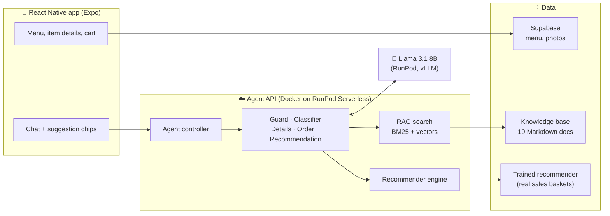
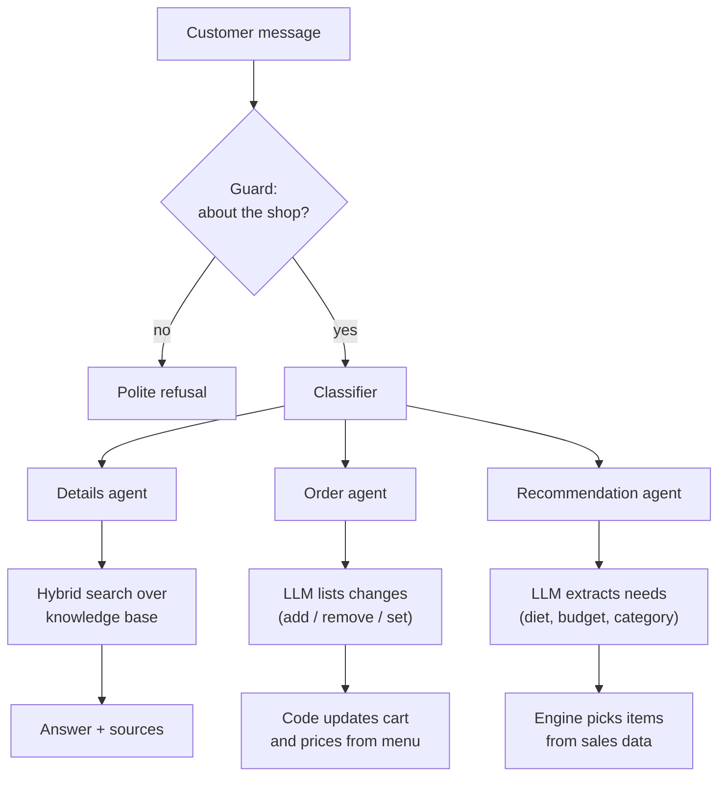

# Bleecker & Bloom: AI Coffee Shop Assistant ☕

A coffee-shop ordering app with an AI assistant that answers questions, recommends items, and takes orders through chat, grounded in the shop's real menu and real sales data.

**🔗 Live demo:** https://bleecker-and-bloom.expo.app
<sub>Works on phone and desktop. The first chat message can take about a minute while the servers wake up.</sub>

> **In one line:** an AI barista that answers questions, recommends drinks and food, and takes orders for a coffee shop, without making things up.

---

## Contents

1. [What it's for](#what-its-for)
1. [Why I built it](#why-i-built-it)
2. [What it does](#what-it-does)
3. [Architecture](#architecture)
4. [How a message is handled](#how-a-message-is-handled)
5. [Key design decisions](#key-design-decisions)
6. [Results](#results)
7. [Tech stack](#tech-stack)
8. [Project structure](#project-structure)
9. [Run it locally](#run-it-locally)
10. [Deployment](#deployment)

---

## What it's for

Bleecker & Bloom is a coffee shop's ordering app with a built-in AI assistant. Customers can browse the menu and order the usual way, or just chat with it like they would with a barista.

**For customers**

- **Ask questions:** "Is the almond croissant safe for a nut allergy?", "Do you deliver?", "What are your hours?" Answers come from the shop's own information, with sources.
- **Order by chatting:** "Two lattes and a croissant" → "make it one latte" → "that's all". The cart updates and the total is always correct.
- **Get suggestions:** "Something vegan under $5" or "What goes with my latte?" Recommendations are based on what real customers buy together.
- **Browse and buy:** menu with photos, item details, cart, and checkout.

**For the coffee shop**

- **Less work for staff:** the assistant answers the same questions (hours, allergens, delivery) all day.
- **More sales:** useful "you might also like…" suggestions add items to orders, like "Customers also bought" in online stores.
- **Safety and trust:** it never invents menu items or prices, and allergy answers come straight from the allergen data.
- **Always available:** customers can order or ask questions at any hour, from their phone.

## Why I built it

Chatbots for ordering usually fail in the same ways:

- **They make things up.** A plain LLM will happily invent menu items, prices, or allergy facts.
- **They lose the order.** Carts get scrambled over a long conversation, and totals don't add up.
- **Their recommendations are generic.** "You might like a muffin" isn't based on what customers actually buy.

The goal of this project was an assistant a real coffee shop could trust: **the LLM understands the customer and writes the reply, while code and data supply the facts** (the menu, prices, allergens, and what people actually buy together).

## What it does

| Feature | How it works |
|---|---|
| 💬 **Answers questions** | Searches a knowledge base of 19 documents (menu, allergens, delivery, loyalty program, FAQ) and shows the sources under each answer |
| 🛒 **Takes orders by chat** | "Two lattes and a croissant" updates the cart; prices always come from the menu |
| ✨ **Recommends items** | Suggests what goes well together based on 39,192 real coffee-shop baskets, with dietary filters and a reason for each suggestion |
| 🛡️ **Stays on topic and safe** | Blocks unrelated requests; allergy questions are answered straight from the allergen data, not by the model |
| 📱 **Full shop app** | 64-item menu in 8 categories with photos, item details, cart, and checkout, on web and mobile |

## Architecture



**Three parts:**

- **App:** React Native with Expo, so one codebase runs on web, iOS, and Android. The menu and photos load from Supabase.
- **Agent API:** a Python service packaged as a Docker image and run on RunPod Serverless. It routes each message to the right agent.
- **LLM:** Llama 3.1 8B served by vLLM on RunPod. Any OpenAI-compatible model works (OpenAI, Ollama) by changing a setting.

### The agents

| Agent | Job |
|---|---|
| **Guard** | Lets through only requests about the shop |
| **Classifier** | Decides which specialist should answer |
| **Details** | Answers questions using retrieval (RAG) over the knowledge base, with citations |
| **Order Taking** | Updates the cart, totals it, and confirms the order |
| **Recommendation** | Turns a request ("something vegan under $5") into filters and asks the recommender engine |

## How a message is handled



Every reply has the same shape (`role`, `content`, `memory`). The `memory` carries the cart, the sources, and recommendation chips, which the app displays.

## Key design decisions

| Decision | Why |
|---|---|
| **The LLM understands and writes; code decides the facts** | The assistant can never recommend or price something the shop doesn't sell |
| **Hybrid search (BM25 + vectors)** | Keyword search catches exact item names; vectors catch paraphrases like "something without milk" |
| **Order changes through a strict JSON schema** | The model can only name real menu items, and code does all the arithmetic, so the cart and total always agree, even with a small 8B model |
| **Allergy answers come straight from the data** | In testing, a small model once called the Almond Croissant safe for nut allergies; safety answers shouldn't depend on the model |
| **Recommender trained on real baskets, no synthetic data** | Suggestions and evaluations reflect what real customers buy |
| **Prices always recomputed on the server** | The app only sends item names and quantities, so prices can't be tampered with |
| **One menu file** (`products.jsonl`) | The app, agents, and recommender all read the same source, so they never disagree |

## Results

All numbers come from offline evaluations you can rerun from `python_code/api`.

| Evaluation | Result |
|---|---|
| **Retrieval:** correct document in top 4 (64 questions) | **98%** |
| **Answers:** correct answers (23 questions) | **23/23** with Llama 3.1 8B and GPT-4o-mini |
| **Honesty:** says "not sure" when the info isn't there (5 questions) | **5/5** |
| **Recommendations:** hidden item found in top 3 (3,508 real baskets) | **33.8%**, vs 7.2% for "most popular" |

Full details are in [ARCHITECTURE.md](ARCHITECTURE.md).

## Tech stack

| Layer | Tools |
|---|---|
| **App** | React Native, Expo Router, TypeScript, NativeWind |
| **Backend** | Python, FastAPI, Docker, RunPod Serverless |
| **AI** | Llama 3.1 8B (vLLM), OpenAI embeddings, Chroma, BM25 |
| **Data** | Supabase (Postgres, Auth, Storage), pandas |
| **Hosting** | Expo Hosting (web), RunPod (API and LLM) |

## Project structure

```
coffee_shop_app/            React Native app
  app/                      Screens: home, details, cart, chat
  components/               Chat, cart, product UI
  services/                 API, products, identity
python_code/
  api/
    agents/                 Guard, classifier, details, order, recommendation
    rag/                    Chunking, hybrid search, evaluations
    recommender/            Training, engine, evaluation
    agent_controller.py     Routes each message through the agents
    main.py                 RunPod serverless entry point
    local_server.py         FastAPI server for local development
    Dockerfile              Image for RunPod
  knowledge_base/           Documents the assistant answers from
  products/                 Menu (products.jsonl) and photos
  dataset/                  Sales data used to train the recommender
supabase/schema.sql         Database tables and security rules
ARCHITECTURE.md             Full design and evaluation write-up
```

## Run it locally

**1. Backend**

```bash
cd python_code
python3.11 -m venv .venv-local && source .venv-local/bin/activate
pip install -r api/requirements.txt
cp .env.local.example .env       # add your LLM and embedding settings
cd api
python -m uvicorn local_server:app --host 0.0.0.0 --port 8000
```

**2. App**

```bash
cd coffee_shop_app
cp .env.local.example .env       # point it at http://localhost:8000
npm ci
npx expo start                   # press w for web
```

More setup detail (RunPod, Supabase, retraining the recommender) is in [python_code/api/README.md](python_code/api/README.md).

## Deployment

**Agent API → RunPod Serverless**

```bash
cd python_code
docker build --platform linux/amd64 -f api/Dockerfile -t <dockerhub-user>/coffee-chatbot:v1 .
docker push <dockerhub-user>/coffee-chatbot:v1
```

Create a RunPod Serverless endpoint (Queue type, CPU worker) from the image and add the environment variables from `.env`.

**Web app → Expo Hosting**

```bash
cd coffee_shop_app
npx expo export -p web
npx eas-cli deploy --prod
```

---

## Acknowledgements

Started from Abdullah Tarek's coffee-shop chatbot tutorial. Product photos are from Wikimedia Commons; see `python_code/products/images/CREDITS.md`. Sales data is a public coffee-shop sample dataset (April 2019).
