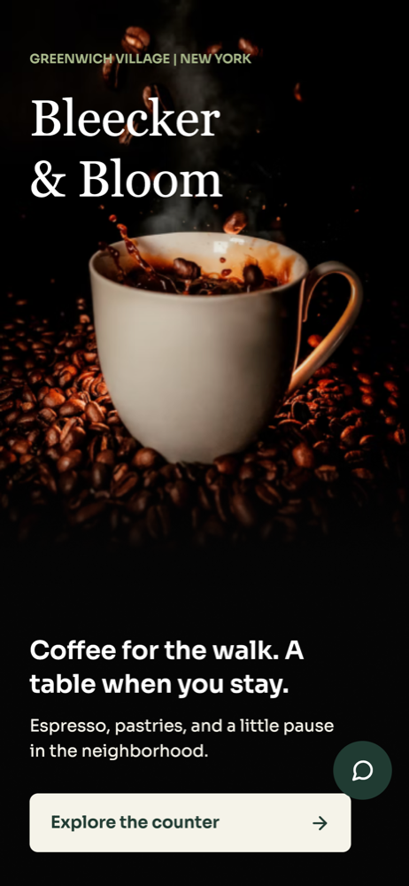
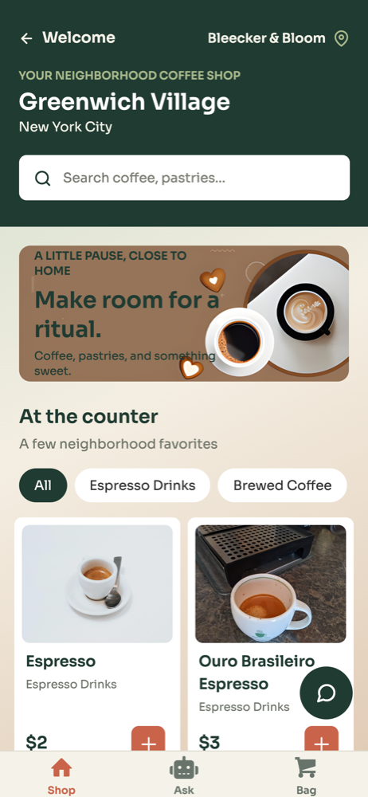
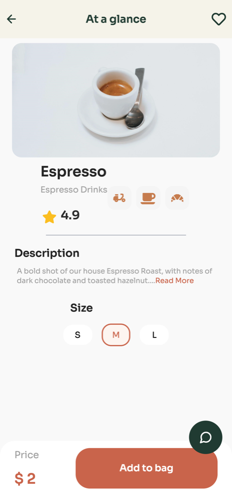
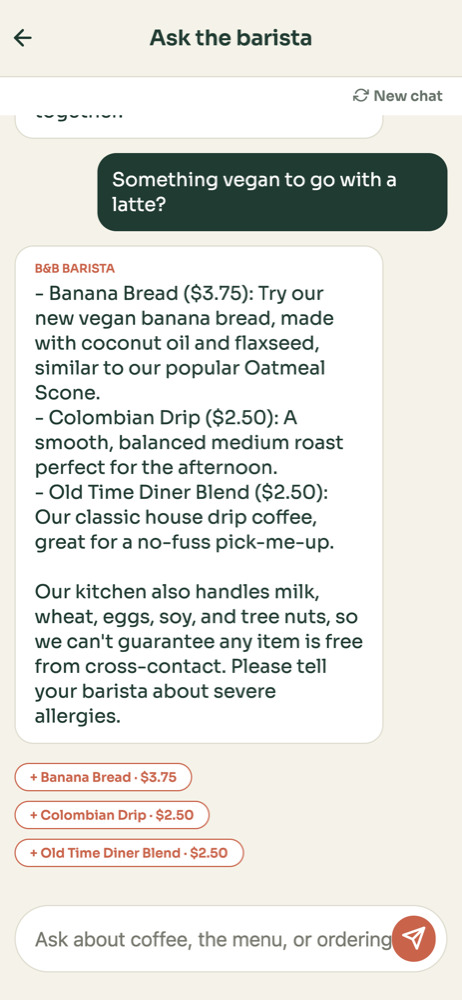
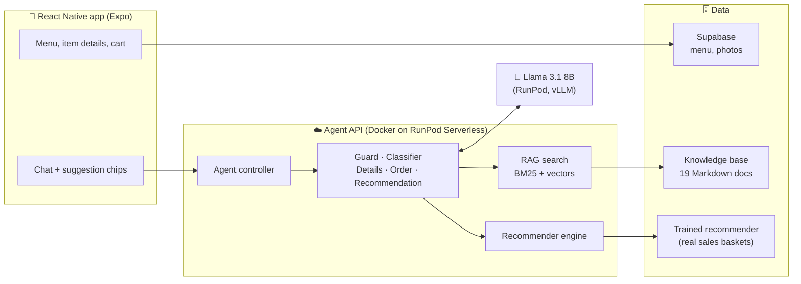
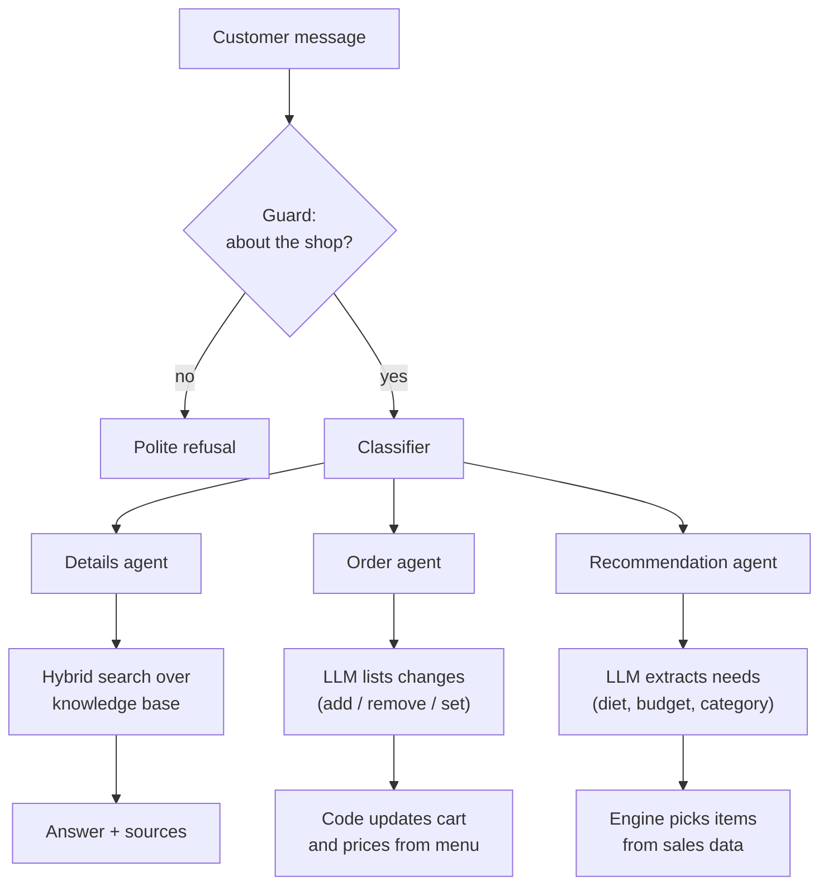

# Bleecker & Bloom: AI Coffee Shop Assistant ☕

**An AI barista that answers questions, recommends drinks and food, and takes orders for a coffee shop, without making things up.**

**🔗 Live demo:** [bleecker-and-bloom.expo.app](https://bleecker-and-bloom.expo.app) <sub>(works on phone and desktop; the first chat message can take about a minute while the servers wake up)</sub>


<table>
  <tr>
    <td align="center"><br><sub><b>Welcome</b></sub></td>
    <td align="center"><br><sub><b>Menu</b></sub></td>
    <td align="center"><br><sub><b>Item details</b></sub></td>
    <td align="center"><br><sub><b>AI barista</b></sub></td>
  </tr>
</table>

<sub>The chat screenshot is a real reply from the deployed assistant: vegan suggestions from the recommender, an allergen note from the knowledge base, and tappable "+ add" chips.</sub>

---

## At a glance

A full-stack, deployed AI product: a cross-platform shopping app plus a multi-agent LLM backend that answers from the shop's own documents, recommends items using a model trained on real sales data, and keeps an accurate cart through conversation.

| | |
|---|---|
| **Built** | End-to-end: mobile/web app, agent backend, retrieval pipeline, recommender, database, cloud deployment |
| **AI techniques** | Multi-agent orchestration, RAG (hybrid search), structured LLM outputs, recommender systems, offline evaluation |
| **Answer accuracy** | **23/23** correct on a labeled test set, **5/5** correctly says "not sure" instead of guessing |
| **Retrieval** | **98%** of questions find the right document in the top 4 |
| **Recommendations** | **4.7×** better than a popularity baseline (33.8% vs 7.2% Hit@3 on 3,508 real baskets) |
| **Deployed** | Agent API in Docker on RunPod Serverless, self-hosted Llama 3.1 8B, web app on Expo Hosting |

## Highlights

- **Designed a 5-agent LLM system** (guard, classifier, and three specialists) that routes each customer message to the right expert.
- **Built a RAG pipeline from scratch:** heading-based chunking of 19 documents, hybrid BM25 + vector search with rank fusion, citations, and query rewriting. It improved first-result accuracy from 70% (keyword only) to 91%.
- **Trained a recommender on 49,894 real sales line items.** I found and fixed a data bug in how receipts were grouped into baskets, which raised accuracy from 25.6% to 33.6%, and added dietary filters, explanations, and cold-start handling for 30 new items.
- **Made a small 8B model reliable** by constraining its output to a JSON schema of real menu items and moving all cart math into code, so orders and totals are always correct.
- **Found and fixed a safety failure through evaluation:** a model called the Almond Croissant safe for nut allergies. Allergy answers now come directly from the allergen data.
- **Shipped it:** Supabase (Postgres with Row Level Security, anonymous auth, storage), a Docker image on RunPod Serverless, and a public web app.

---

## Contents

1. [What it's for](#what-its-for)
2. [The problem](#the-problem)
3. [Architecture](#architecture)
4. [How a message is handled](#how-a-message-is-handled)
5. [Key design decisions](#key-design-decisions)
6. [Evaluation](#evaluation)
7. [Tech stack](#tech-stack)
8. [Project structure](#project-structure)
9. [Run it locally](#run-it-locally)
10. [Deployment](#deployment)

---

## What it's for

Bleecker & Bloom is a coffee shop's ordering app with a built-in AI assistant. Customers can browse the menu and order the usual way, or chat with it like they would with a barista.

**For customers**

- **Ask questions:** "Is the almond croissant safe for a nut allergy?", "Do you deliver?" Answers come from the shop's own information, with sources.
- **Order by chatting:** "Two lattes and a croissant" → "make it one latte" → "that's all". The cart updates and the total is always correct.
- **Get suggestions:** "Something vegan under $5" or "What goes with my latte?" Recommendations come from what real customers buy together.
- **Browse and buy:** a 64-item menu in 8 categories with photos, item details, cart, and checkout.

**For the business**

- **Less work for staff:** routine questions (hours, allergens, delivery) are answered automatically.
- **More sales:** relevant "you might also like…" suggestions increase order size.
- **Trust:** it never invents menu items or prices, and safety answers come straight from the data.
- **Always available:** customers can order at any hour, from their phone.

## The problem

Ordering chatbots usually fail in three ways:

- **They make things up:** a plain LLM invents menu items, prices, or allergy facts.
- **They lose the order:** carts get scrambled over a long conversation, and totals don't add up.
- **Their recommendations are generic:** they aren't based on what customers actually buy.

**My approach:** the LLM understands the customer and writes the reply, while code and data supply the facts (the menu, prices, allergens, and real purchase patterns).

## Architecture



- **App:** React Native with Expo, so one codebase runs on web, iOS, and Android. The menu and photos load from Supabase.
- **Agent API:** a Python service packaged as a Docker image and run on RunPod Serverless.
- **LLM:** Llama 3.1 8B served by vLLM on RunPod. Any OpenAI-compatible model (OpenAI, Ollama) works by changing a setting.

| Agent | Job |
|---|---|
| **Guard** | Lets through only requests about the shop |
| **Classifier** | Decides which specialist should answer |
| **Details** | Answers questions with RAG over the knowledge base, with citations |
| **Order Taking** | Updates the cart, totals it, and confirms the order |
| **Recommendation** | Turns a request ("something vegan under $5") into filters for the recommender engine |

## How a message is handled



## Key design decisions

| Decision | Why |
|---|---|
| **The LLM understands and writes; code decides the facts** | The assistant can never recommend or price something the shop doesn't sell |
| **Hybrid search (BM25 + vectors)** | Keyword search catches exact item names; vectors catch paraphrases like "something without milk" |
| **Order changes through a strict JSON schema** | The model can only name real menu items and code does the arithmetic, so the cart is always right, even with an 8B model |
| **Allergy answers come straight from the data** | Safety answers shouldn't depend on the model |
| **Recommender trained on real baskets, no synthetic data** | Suggestions and evaluations reflect what real customers buy |
| **Confidence over lift for ranking** | Chosen by offline evaluation (33.6% vs 27.9%); lift over-rewards rare pairings |
| **Prices always recomputed on the server** | The app only sends item names and quantities, so prices can't be tampered with |

## Evaluation

Every component has an offline evaluation that can be rerun from `python_code/api`.

**Retrieval** (64 labeled questions)

| Method | Hit@1 | Hit@4 | MRR |
|---|---|---|---|
| Keyword only (BM25) | 70% | 91% | 0.785 |
| Vector only | 89% | 98% | 0.935 |
| **Hybrid (used)** | **91%** | **98%** | **0.943** |

**Answers** (23 factual questions + 5 the documents can't answer)

| Model | Correct | Says "not sure" when it should |
|---|---|---|
| Llama 3.1 8B (self-hosted) | **23/23** | **5/5** |
| GPT-4o-mini | **23/23** | **5/5** |

**Recommendations** (trained on April 1–22, tested on 3,508 baskets from April 23–29)

| Method | Hit@3 |
|---|---|
| Most popular items | 7.2% |
| Original basket grouping | 25.6% |
| **Fixed grouping + one-drink rule (used)** | **33.8%** |

Full write-up: [ARCHITECTURE.md](ARCHITECTURE.md)

## Tech stack

| Layer | Tools |
|---|---|
| **App** | React Native, Expo Router, TypeScript, NativeWind |
| **Backend** | Python, FastAPI, Docker, RunPod Serverless |
| **AI / ML** | Llama 3.1 8B (vLLM), OpenAI embeddings, Chroma, BM25, pandas |
| **Data** | Supabase (Postgres, Row Level Security, Auth, Storage) |
| **Hosting** | Expo Hosting (web), RunPod (API and LLM) |

## Project structure

```
coffee_shop_app/            React Native app
  app/                      Screens: home, details, cart, chat
  components/               Chat, cart, product UI
  services/                 API, products, identity
python_code/
  api/
    agents/                 Guard, classifier, details, order, recommendation
    rag/                    Chunking, hybrid search, evaluations
    recommender/            Training, engine, evaluation
    agent_controller.py     Routes each message through the agents
    main.py                 RunPod serverless entry point
    local_server.py         FastAPI server for local development
    Dockerfile              Image for RunPod
  knowledge_base/           Documents the assistant answers from
  products/                 Menu (products.jsonl) and photos
  dataset/                  Sales data used to train the recommender
supabase/schema.sql         Database tables and security rules
ARCHITECTURE.md             Full design and evaluation write-up
```

## Run it locally

**1. Backend**

```bash
cd python_code
python3.11 -m venv .venv-local && source .venv-local/bin/activate
pip install -r api/requirements.txt
cp .env.local.example .env       # add your LLM and embedding settings
cd api
python -m uvicorn local_server:app --host 0.0.0.0 --port 8000
```

**2. App**

```bash
cd coffee_shop_app
cp .env.local.example .env       # point it at http://localhost:8000
npm ci
npx expo start                   # press w for web
```

More setup detail (RunPod, Supabase, retraining the recommender) is in [python_code/api/README.md](python_code/api/README.md).

## Deployment

**Agent API → RunPod Serverless**

```bash
cd python_code
docker build --platform linux/amd64 -f api/Dockerfile -t <dockerhub-user>/coffee-chatbot:v1 .
docker push <dockerhub-user>/coffee-chatbot:v1
```

Create a RunPod Serverless endpoint (Queue type, CPU worker) from the image and add the environment variables from `.env`.

**Web app → Expo Hosting**

```bash
cd coffee_shop_app
npx expo export -p web
npx eas-cli deploy --prod
```
